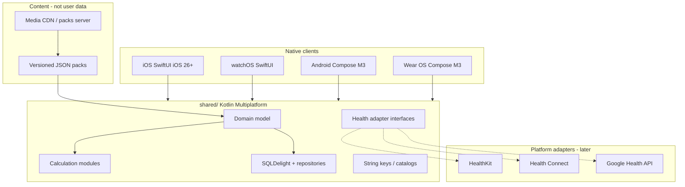

# OmniGart architecture

OmniGart is a **local-first** fitness, nutrition and recovery app. User data never leaves the device except as **client-side encrypted** backups (future). A content server may ship media/exercise packs only.

## High-level

## Modules

| Path | Role |
|------|------|
| `shared/` | KMP core: domain, calcs, SQLDelight, i18n keys, health interfaces |
| `shared/planning/` | Rule-based planning + content validation (JVM/common; content under `content/exercises/`) |
| `androidApp/` | Phone UI (Jetpack Compose, Material 3 + design tokens/icons) |
| `wearApp/` | Wear OS UI (Compose for Wear OS Material 3) |
| `iosApp/` | XcodeGen project: iOS app + schemes; embeds watch app |
| `watchApp/` | watchOS SwiftUI sources (referenced by XcodeGen) |
| `design/` | DTCG tokens, icons, app icon, generated Swift/Android/Compose outputs |
| `content/exercises/` | Versioned exercise JSON, templates, locales, schemas |
| `docs/evidence/` | Citation JSON + schema for formula references |

## Persistence

- **SQLDelight** schema in `shared/src/commonMain/sqldelight/`
- Drivers: Android `AndroidSqliteDriver`; Apple `NativeSqliteDriver`
- Phase 0: unencrypted SQLite file `omnigart.db`
- Planned: SQLCipher / encrypted driver behind the same repository APIs

## Health integrations (interfaces only in Phase 0)

Defined in `shared/.../health/HealthAdapters.kt`:

- `HealthKitAdapter`
- `HealthConnectAdapter`
- `GoogleHealthApiAdapter`

**Google Fit is out of scope.**

## watchOS KMP notes

Targets enabled: `watchosArm64`, `watchosSimulatorArm64` (`watchosX64` deprecated).
Frameworks are synced into `shared/build/xcode-frameworks/<Config>/<SDK_NAME>/` via `:shared:syncXcodeFrameworks` for XcodeGen `FRAMEWORK_SEARCH_PATHS`.

Supported in Phase 0: Kotlin/Native stdlib, coroutines, kotlinx-datetime, kotlinx-serialization, SQLDelight native driver.

If a future dependency lacks watchOS artifacts, keep the API in `commonMain` / `iosMain` and provide a `watchosMain` stub or move the dependency behind an `expect`/`actual` boundary. See `docs/OPEN_QUESTIONS.md`.

## Localisation

- Source + fallback: **en-GB**
- Phase 0 locales: **en-GB**, **uk**
- Planned: pl, be, kk (Cyrillic), ka, es, fr, de, cs, zh-Hans
- **Never** add `ru`
- CI script: `scripts/check_no_ru_locale.sh`

## Project generation (Apple)

**XcodeGen** is used (`iosApp/project.yml`) so the `.xcodeproj` is reproducible from YAML. Justification vs Tuist: smaller toolchain, YAML-only, fits a KMP-consumed XCFramework workflow without Tuist's Swift-based manifest and caching stack. Generate with `xcodegen` on macOS (see README).

## Anti-patterns avoided

- No business logic in SwiftUI/Compose views beyond presentation
- No `GlobalScope`, no Kotlin `!!` in shared/core code
- No singleton mutable app state; `OmniGartCore` is constructed per process entry and owns repositories
- Main-thread DB work is acceptable for Phase 0 smoke shells only; later move to background dispatchers

## Health integrations (first release)

On-device: HealthKit (Apple) and Health Connect (Android) implement `HealthClient`.
Cloud: `GoogleHealthApiClient` uses OAuth PKCE with tokens in Keychain/Keystore (no OmniGart server).
Formula selection uses strategy interfaces in `calc/strategy` (BMR, HRmax, body fat, 1RM, HR zones).
Baevsky stress index is available from RR intervals (`calc/BaevskyStressIndex`).
